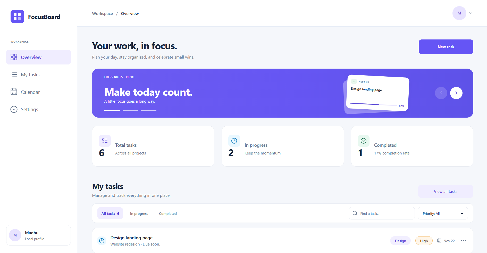
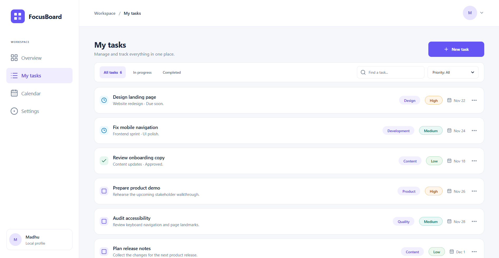
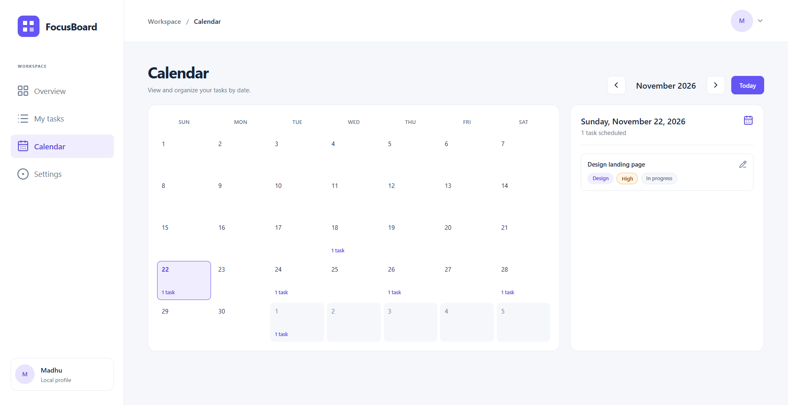
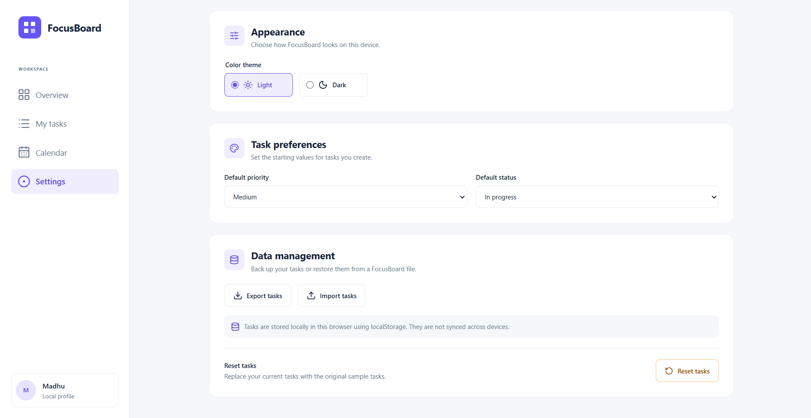
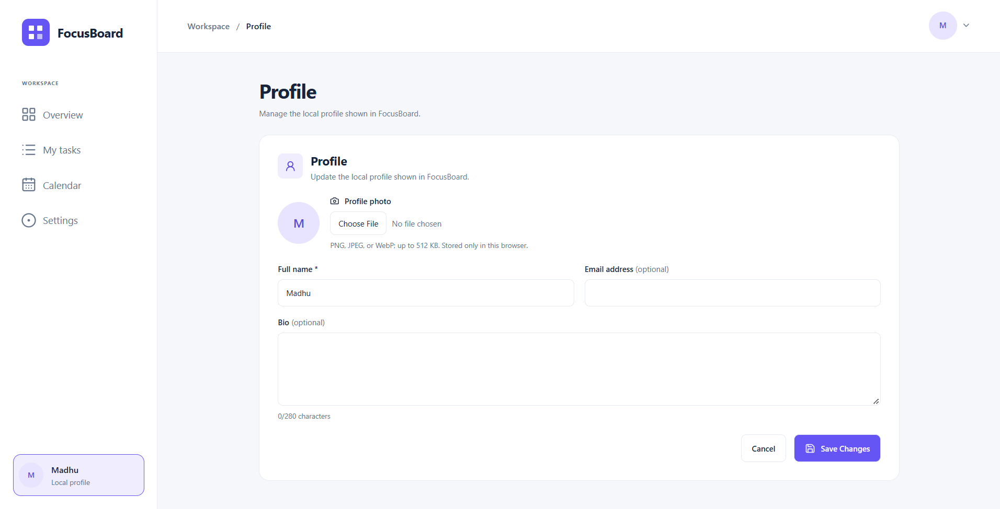

# FocusBoard

**A responsive productivity and task management dashboard built with React.**

FocusBoard helps users organize tasks, track progress, manage schedules, customize task preferences and themes, and maintain a local profile. It is a frontend-only application: data is stored in the browser and is not synchronized to a server.

## Table of contents

- [Project overview](#project-overview)
- [Features](#features)
- [Technology stack](#technology-stack)
- [Screenshots](#screenshots)
- [Project structure](#project-structure)
- [Getting started](#getting-started)
- [Available scripts](#available-scripts)
- [Using FocusBoard](#using-focusboard)
- [Data storage and limitations](#data-storage-and-limitations)
- [Deployment](#deployment)
- [Future improvements](#future-improvements)
- [Repository](#repository)

## Project overview

FocusBoard brings task planning into one responsive interface. Users can review task statistics on the dashboard, manage tasks and their status, see due dates on a monthly calendar, configure appearance and task defaults, and update profile information.

The application uses React Router for its main pages:

| Page | URL |
| --- | --- |
| Dashboard | `/` |
| Tasks | `/tasks` |
| Calendar | `/calendar` |
| Settings | `/settings` |
| Profile | `/profile` |

## Features

- **Dashboard:** Task statistics, a Focus Notes carousel, and an overview of current tasks.
- **Task management:** Create, edit, and delete tasks; change task status from the task list.
- **Search and filters:** Search tasks and filter by status and priority.
- **Calendar:** Navigate months, return to today, select dates, and view or edit scheduled tasks.
- **Settings:** Choose a light or dark theme and set default priority and status for new tasks.
- **Task backup:** Export tasks as JSON or import and validate a FocusBoard backup. Replacing existing tasks requires confirmation.
- **User profile:** Manage a local profile with a name and optional contact details, bio, and avatar.
- **Responsive layouts:** Adapted for desktop, tablet, and mobile screens.
- **Browser persistence:** Tasks, preferences, and profile information are saved in `localStorage` for the current browser origin.

## Technology stack

- **React 19** and **React Hooks** for the user interface and state
- **React Router 7** for client-side routes
- **Vite 8** for development and production builds
- **JavaScript** and **CSS3**, including responsive styles and CSS variables
- **lucide-react** for icons
- **localStorage** for browser-local persistence
- **Oxlint** for linting
- **Git and GitHub** for version control and source hosting
- **Vercel** for deployment

## Screenshots

### Dashboard



### Tasks

<!-- The requested plural filename is not present; this image uses the existing task.png capture. -->


### Calendar

<!-- The requested calendar.png filename is not present; this image uses the existing calender.png capture. -->


### Settings



### Profile



## Project structure

```text
FocusBoard/
├── public/
│   └── screenshots/
│       ├── calender.png
│       ├── create_task.png
│       ├── dashboard.png
│       ├── mobileView.png
│       ├── profile.png
│       ├── settings.png
│       └── task.png
├── src/
│   ├── components/
│   │   ├── calendar/
│   │   │   └── CalendarPage.jsx
│   │   ├── common/
│   │   │   ├── Brand.jsx
│   │   │   ├── ConfirmDialog.jsx
│   │   │   └── ProfileAvatar.jsx
│   │   ├── dashboard/
│   │   │   ├── FocusCarousel.jsx
│   │   │   └── StatsCards.jsx
│   │   ├── layout/
│   │   │   ├── Header.jsx
│   │   │   ├── MobileNav.jsx
│   │   │   └── Sidebar.jsx
│   │   ├── settings/
│   │   │   ├── ProfilePage.jsx
│   │   │   ├── ProfileSettings.jsx
│   │   │   └── SettingsPage.jsx
│   │   └── tasks/
│   │       ├── TaskCard.jsx
│   │       ├── TaskFilters.jsx
│   │       ├── TaskList.jsx
│   │       ├── TaskModal.jsx
│   │       └── TaskSection.jsx
│   ├── data/
│   │   └── initialTasks.js
│   ├── hooks/
│   │   ├── usePreferences.js
│   │   ├── useProfile.js
│   │   └── useTasks.js
│   ├── styles/
│   │   ├── brand.css
│   │   ├── calendar.css
│   │   ├── carousel.css
│   │   ├── global.css
│   │   ├── header.css
│   │   ├── layout.css
│   │   ├── navigation.css
│   │   ├── profile.css
│   │   ├── responsive.css
│   │   ├── settings.css
│   │   ├── sidebar.css
│   │   ├── statistics.css
│   │   ├── task-cards.css
│   │   ├── task-dialog.css
│   │   ├── task-filters.css
│   │   ├── themes.css
│   │   └── variables.css
│   ├── utils/
│   │   ├── profileHelpers.js
│   │   ├── taskBackup.js
│   │   └── taskHelpers.js
│   ├── App.jsx
│   ├── App.css
│   ├── index.css
│   └── main.jsx
├── .gitignore
├── .oxlintrc.json
├── AI_USAGE.md
├── index.html
├── package.json
├── package-lock.json
├── vercel.json
└── vite.config.js
```

## Getting started

### Prerequisites

- Node.js `^20.19.0` or `>=22.12.0`
- npm
- Git

### Install and run

In Windows PowerShell, clone the repository, install dependencies, and start the development server:

```powershell
git clone https://github.com/MadhuTech2024/FocusBoard.git
Set-Location -Path ".\FocusBoard"
npm install
npm run dev
```

Open [http://localhost:5173/](http://localhost:5173/) in a browser. If that port is already in use, Vite prints the alternate local URL in the terminal.

## Available scripts

Run these commands from the project directory:

| Command | Description |
| --- | --- |
| `npm run dev` | Start the Vite development server. |
| `npm run lint` | Run Oxlint on the project. |
| `npm run build` | Create the production build in `dist/`. |
| `npm run preview` | Preview the production build locally after building. |

## Using FocusBoard

1. Review task totals and progress on the dashboard.
2. Create a task using **New task**. Use a task’s action menu to edit or delete it, and its status control to change status.
3. Use search and the status and priority filters to narrow the task list.
4. Open **Calendar** to navigate months, select a date, and see tasks scheduled for it.
5. In **Settings**, choose a theme and set defaults for newly created tasks.
6. Update profile information on the **Profile** page.
7. Export a JSON backup from Settings. Importing a backup validates its contents and asks for confirmation before replacing the current task collection.

## Data storage and limitations

FocusBoard is frontend-only. Tasks, preferences, and profile data are saved in the browser’s `localStorage` for the current origin. The application has no backend database, authentication service, cloud backup, or multi-device synchronization. Data stored in one browser or origin is not automatically available in another.

Browser storage may be cleared by the user or browser. Export a task backup if you want a separate copy. Import replaces the current task collection after confirmation; it does not merge tasks.

## Deployment

The live application is available at [https://focusboard-workspace.vercel.app/](https://focusboard-workspace.vercel.app/).

The project includes a Vercel rewrite for client-side routes. With the GitHub repository connected to Vercel, pushes to the configured production branch trigger automatic deployments. Deployment behavior is controlled by the Vercel project settings.

## Future improvements

These are possible enhancements, not currently implemented features:

- Add a dedicated automated test suite for task, calendar, settings, and import workflows.
- Offer optional cross-device synchronization through a backend service.
- Explore additional backup workflows, such as merging selected tasks from an import.

## Repository

[github.com/MadhuTech2024/FocusBoard](https://github.com/MadhuTech2024/FocusBoard)

For AI assistance and developer responsibilities, see [AI_USAGE.md](./AI_USAGE.md).
